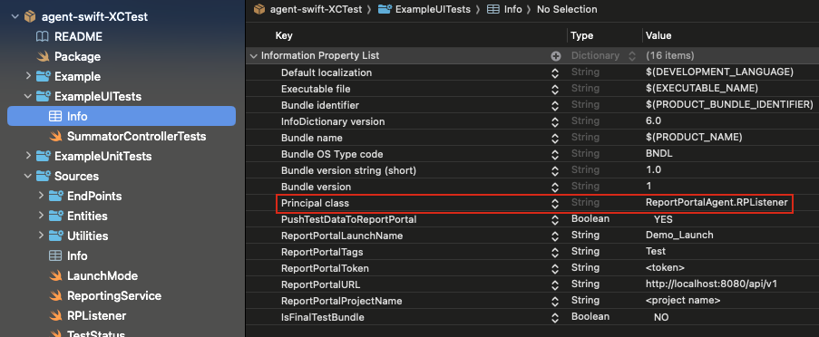
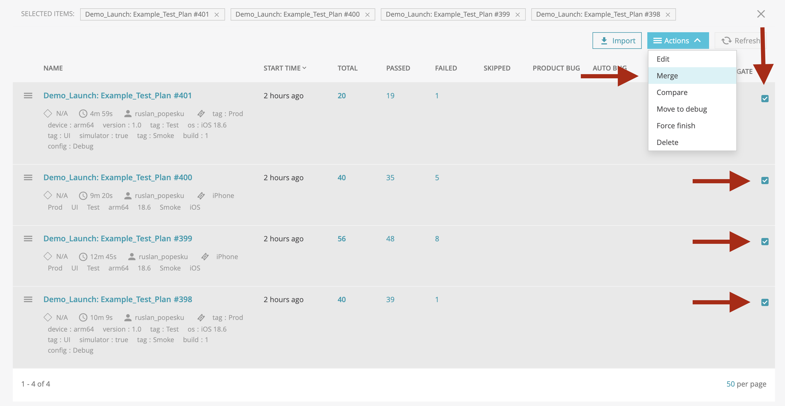

# ReportPortal Agent for XCTest

> Real-time reporting of XCTest / XCUITest runs to [ReportPortal](https://reportportal.io) — with first-class **parallel execution** and **SauceLabs multi-device merge** support.

[](http://cocoapods.org/pods/ReportPortal)
[](https://swift.org/package-manager/)
[](https://swift.org)
[](http://cocoapods.org/pods/ReportPortal)
[](https://github.com/reportportal/agent-swift-XCTest/actions/workflows/validate.yml)
[](https://opensource.org/licenses/Apache-2.0)
[](https://slack.epmrpp.reportportal.io/)
[](http://stackoverflow.com/questions/tagged/reportportal)

The agent hooks into XCTest via [`XCTestObservation`](https://developer.apple.com/documentation/xctest/xctestobservation) and streams your suites, test cases, statuses, logs, and attachments to a ReportPortal launch as they run — no changes to your test code required.

---

## Contents

- [Features](#features)
- [Compatibility](#compatibility)
- [Installation](#installation)
- [Quick Start](#quick-start)
- [Configuration Reference](#configuration-reference)
- [Parallel Test Execution (v4.0+)](#parallel-test-execution-v40)
- [One launch on real devices](#one-launch-on-real-devices)
- [SauceLabs Real-Device Merge (legacy)](#saucelabs-real-device-merge-legacy)
- [How It Works](#how-it-works)
- [Contributing](#contributing)
- [Authors](#authors)
- [License](#license)

---

## Features

- 📡 **Zero-touch reporting** — add the agent as your test target's principal class; no test-code changes.
- 🧱 **Full hierarchy** — launches → suites → test cases, with statuses, durations, logs, and attachments.
- ⚡ **Parallel-execution ready (v4.0+)** — multiple simulator clones/devices report into a single launch via a shared `RP_LAUNCH_UUID`.
- ☁️ **SauceLabs real-device merge** — a standout extra on top of all-platform support: each isolated device creates its own launch, and a vendored post-run script merges them into one. Copy-paste guide + script + agent prompt in [docs/SAUCELABS_SETUP.md](docs/SAUCELABS_SETUP.md).
- 🧩 **Flexible configuration** — env vars override `Info.plist`, with sensible defaults.
- 🏷️ **Metadata & tags** — device/OS attributes, custom tags, and test-plan-aware launch names.
- 🔁 **Idempotent finalize** — a launch already finished (HTTP 409) is treated as success, not an error.

## Compatibility

| | Minimum |
|---|---|
| Swift | 5.5 |
| Xcode | 13 |
| iOS | 15.0 |
| macOS | 12.0 |
| tvOS | 15.0 |
| watchOS | 8.0 |
| ReportPortal | 5.0 (API v2; merge endpoint requires 5.0+) |

> Parallel execution relies on Swift Concurrency, hence the iOS 15 / Swift 5.5 floor.

## Installation

### Swift Package Manager (recommended)

In Xcode: **File → Add Package Dependencies…**, enter the repository URL, and add the **`ReportPortalAgent`** library to your **test** target.

```text
https://github.com/reportportal/agent-swift-XCTest.git
```

Or in `Package.swift`:

```swift
.package(url: "https://github.com/reportportal/agent-swift-XCTest.git", from: "4.1.0")
```

```swift
.testTarget(
    name: "YourUITests",
    dependencies: [.product(name: "ReportPortalAgent", package: "agent-swift-XCTest")]
)
```

### CocoaPods

```ruby
pod 'ReportPortal'
```

```bash
pod install
```

## Quick Start

**1. Give your test target an `Info.plist`.** If it doesn't have one, create `YourTests/Info.plist` and set the target's *Info.plist File* build setting to that path.

**2. Add the ReportPortal keys** (see the [full reference](#configuration-reference)):

```xml
<key>NSPrincipalClass</key>
<string>ReportPortalAgent.RPListener</string>   <!-- CocoaPods: ReportPortal.RPListener -->

<key>PushTestDataToReportPortal</key>
<true/>
<key>ReportPortalURL</key>
<string>https://reportportal.example.com</string>  <!-- base URL; /api/v2/{project} is appended -->
<key>ReportPortalProjectName</key>
<string>your_project</string>
<key>ReportPortalToken</key>
<string>your_api_token</string>
<key>ReportPortalLaunchName</key>
<string>Regression</string>
```



**3. Run your tests** as usual (`xcodebuild test …` or ⌘U). A launch appears in ReportPortal in real time.

## Configuration Reference

### `Info.plist` keys

| Key | Type | Required | Description |
|-----|------|----------|-------------|
| `NSPrincipalClass` | String | ✅ | `ReportPortalAgent.RPListener` (SPM) or `ReportPortal.RPListener` (CocoaPods). May be your own `XCTestObservation`. |
| `PushTestDataToReportPortal` | Bool **or** String | ✅ | Master on/off switch. `true`/`yes`/`1` enable reporting. |
| `ReportPortalURL` | String | ✅ | Base URL of your instance. The agent appends `/api/v2/{project}`. |
| `ReportPortalProjectName` | String | ✅ | ReportPortal project name. |
| `ReportPortalToken` | String | ✅ | API token (from RP account settings). |
| `ReportPortalLaunchName` | String | ✅ | Launch name. |
| `ReportPortalTags` | String | — | Comma-separated tags. |
| `IsDebugLaunchMode` | Bool | — | Marks the launch as debug mode. |
| `TestNameRules` | Dict | — | Display-name transforms (see below). |
| `ReportPortalLaunchUUID` | String | — | Run-unique value so every shard reports into **one** launch. See [one launch on real devices](#one-launch-on-real-devices-v41). |
| `ReportPortalMergeGroup` | String | — | Tags launches for the legacy SauceLabs post-run merge. |
| `ReportPortalSkipFinish` | Bool **or** String | — | Defers launch finalization. Defaults to **on** when `ReportPortalLaunchUUID` is set. |

### Environment variables

Env vars take priority over `Info.plist` (useful in CI where `Info.plist` is baked at build time):

| Variable | Purpose |
|----------|---------|
| `RP_LAUNCH_UUID` | Shared launch UUID so parallel workers report into **one** launch. |
| `RP_MERGE_GROUP` | Overrides `ReportPortalMergeGroup`. |
| `RP_SKIP_FINISH` | Overrides `ReportPortalSkipFinish` (`true`/`yes`/`1` vs `false`/`no`/`0`). |
| `RP_CI_RUN_ID` | Disambiguates concurrent CI runs; falls back to `GITHUB_RUN_ID`. |
| `TEST_PLAN_NAME` | Appends the test-plan name to the launch name. |

### `TestNameRules`

```xml
<key>TestNameRules</key>
<dict>
    <key>StripTestPrefix</key><true/>          <!-- testLoginWorks → LoginWorks -->
    <key>WhiteSpaceOnUnderscore</key><true/>   <!-- login_works   → login works -->
    <key>WhiteSpaceOnCamelCase</key><true/>    <!-- LoginWorks     → Login Works -->
</dict>
```

### Test plan name in the launch name

Add `TEST_PLAN_NAME` to your `.xctestplan` (or override per-run in CI) to get launch names like `Regression: Smoke_Tests`:

```json
{ "defaultOptions": { "environmentVariableEntries": [ { "key": "TEST_PLAN_NAME", "value": "Smoke Tests" } ] } }
```

```bash
TEST_PLAN_NAME="Nightly" xcodebuild test …   # CI override
```

Spaces are replaced with underscores for compatibility.

## Parallel Test Execution (v4.0+)

Run tests across multiple simulator clones simultaneously to cut pipeline time, while preserving the test hierarchy in ReportPortal.

### Distribution vs. duplication

Two modes both use the word "parallel" but behave very differently:

| Mode | Command | What happens |
|------|---------|--------------|
| **Distribution** (recommended) | Single `-destination` + `-maximum-parallel-testing-workers N` | Xcode clones the simulator and **distributes** test classes across clones — each test runs exactly once |
| **Device matrix** | Multiple `-destination` flags | Each device runs the **full** suite independently — tests are **duplicated** (3 devices × 156 tests = 468 results) |

Use distribution to go faster. Use device matrix to verify behaviour across specific device types.

### One shared launch (distribution)

The test plan expands `$(RP_LAUNCH_UUID)` as an **Xcode build setting**, not a shell environment variable. Shell `export` does not reach the test processes. Pass the UUID as a trailing `xcodebuild` build-setting argument:

```bash
# ✅ Works — UUID passed as a build setting
UUID=$(uuidgen)
xcodebuild test -scheme YourScheme -testPlan YourPlan \
  -destination 'platform=iOS Simulator,name=iPhone 17 Pro' \
  -parallel-testing-enabled YES \
  -maximum-parallel-testing-workers 4 \
  RP_LAUNCH_UUID="$UUID"

# ❌ Does NOT work — shell export is not an Xcode build setting
export RP_LAUNCH_UUID=$(uuidgen)
xcodebuild test …
```

The first clone to call `POST /launch` creates the launch; the other clones receive HTTP 409 and treat it as a successful join. All clones report into the single launch.

> ⚠️ **Don't generate the UUID in a build-phase script.** Build phases only run when sources change, so a re-run without code changes reuses a stale UUID and joins the previous run's (already-finished) launch.

### Xcode IDE (⌘U)

When you press ⌘U, `$(RP_LAUNCH_UUID)` resolves to an empty string (no build setting is provided), the agent sees an empty env var, and each parallel worker process generates its own UUID — producing N separate launches. This is **by design** for local development.

To get a single launch from ⌘U, set a concrete UUID directly in the test plan's environment variables (open the `.xctestplan` file → Configurations → Environment Variables → change `$(RP_LAUNCH_UUID)` to a fixed UUID string). Change it before each run to avoid joining the previous run's already-finished launch.

For local runs that produce separate launches you can also merge them by hand in **ReportPortal → Launches → Merge**.



### Worker-count guidance

| Environment | Workers |
|-------------|---------|
| Local (8+ cores) | 4 |
| Local (4–6 cores) | 2–3 |
| GitHub Actions | 2 |
| Self-hosted (N cores) | N / 2 |

## One launch on real devices

Real-device farms never deliver environment variables to the XCUITest process — on
SauceLabs `env` is [Virtual Devices Only](https://docs.saucelabs.com/mobile-apps/automated-testing/espresso-xcuitest/xctest-config/)
([saucectl#398](https://github.com/saucelabs/saucectl/issues/398)) — and the `.xctestrun`
is regenerated by the farm. The **test bundle's `Info.plist` is the only channel that
reaches every shard**, so the launch UUID can be supplied there:

```xml
<key>ReportPortalLaunchUUID</key>
<string>$(RP_LAUNCH_UUID)</string>
```

```yaml
env:
  RP_LAUNCH_UUID: ${{ github.run_id }}-${{ github.run_attempt }}   # any run-unique string
```

```bash
xcodebuild build-for-testing -scheme YourScheme \
  -destination 'generic/platform=iOS' -derivedDataPath ./DerivedData \
  RP_LAUNCH_UUID="$RP_LAUNCH_UUID"
```

Every shard compiled from that bundle reports into the same launch: the first
`POST /launch` creates it, the rest join on HTTP 409. Retries that re-run the same bundle
join it too. No post-run merge is needed.

The value is used as the launch id verbatim, so any run-unique string works — a UUID is
always safe, and `${{ github.run_id }}-${{ github.run_attempt }}` needs no shell step.

**The agent does not finalize a launch whose UUID came from the `Info.plist`**: that
launch is shared, and finishing it force-finishes every item still running in the other
shards with the status of that finish request. Close the run once, after all shards are done:

```bash
curl -sf -X PUT -H "Authorization: Bearer $RP_TOKEN" -H "Content-Type: application/json" \
  -d "{\"endTime\":\"$(date +%s000)\"}" \
  "$RP_ENDPOINT/api/v1/$RP_PROJECT/launch/$RP_LAUNCH_UUID/finish"
```

`RP_LAUNCH_UUID` as an **environment variable** keeps its existing behaviour (parallel
simulator clones on one machine, agent finalizes normally) and takes priority over the
plist.

## SauceLabs Real-Device Merge (legacy)

SauceLabs real devices are isolated — they share neither a filesystem nor environment variables, so the simulator-style shared-UUID approach can't work. Instead each device creates its own launch tagged with a **run-unique `merge_group`**, each device finalizes its own launch normally (leave `ReportPortalSkipFinish` **off**), and after the run a small post-run script merges exactly that run's launches into one.

👉 **Full copy-paste recipe** — setup steps, the merge script to vendor, a GitHub Actions workflow, and a prompt you can hand to your AI coding agent to wire it into your own repo — is in **[docs/SAUCELABS_SETUP.md](docs/SAUCELABS_SETUP.md)**.

## How It Works

```text
XCTest run
   │  XCTestObservation callbacks
   ▼
RPListener ──► LaunchUUID           (launch identity: shared RP_LAUNCH_UUID or per-worker UUID)
   │            │
   │            ▼
   └─────────► ReportingService ──► HTTPClient ──► ReportPortal API v2
                (async/await, stateless suite/test/log calls)
```

- **`RPListener`** — the `XCTestObservation` entry point; resolves configuration and translates test events into API calls. Uses a "launch gate" Task to guarantee launch exists before any suites/tests are reported.
- **`LaunchUUID`** — resolves launch UUID once per process (`RP_LAUNCH_UUID` env var or auto-generated).
- **`ReportingService`** — stateless async/await wrapper over the ReportPortal v2 API.
- **Idempotency** — joining an existing launch (HTTP 409 on start) and finalizing an already-finished launch (HTTP 409 on finish) are both treated as success.

## Contributing

```bash
swift build                                   # build the library
xcodebuild test -scheme Example \
  -destination 'platform=iOS Simulator,name=iPhone 16' \
  -only-testing:ExampleUnitTests              # fast unit tests
```

Issues and pull requests are welcome. Please run the test suite above before opening a PR.

## Authors

- [@rusel95](https://github.com/rusel95) · <ruslanpopesku95@gmail.com>
- ReportPortal Team · <support@reportportal.io>
- [@DarthRumata](https://github.com/DarthRumata) (Stas Kirichok, [Windmill Smart Solutions](https://github.com/Windmill-Smart-Solutions))
- @SergeVKom · <sergvkom@gmail.com> (original library)

## License

Licensed under the [Apache 2.0](https://www.apache.org/licenses/LICENSE-2.0) license — see the [LICENSE](LICENSE) file.
